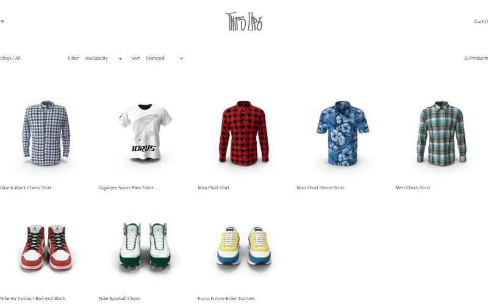
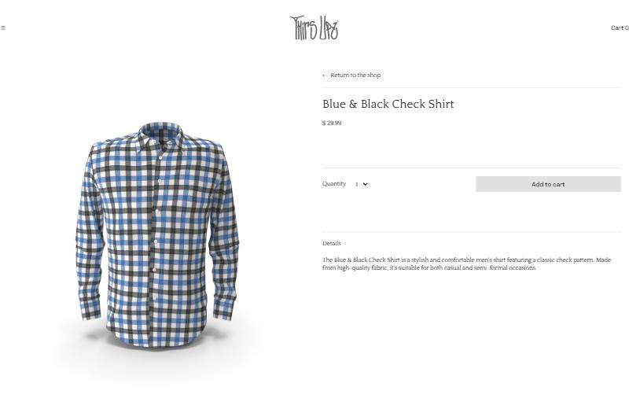
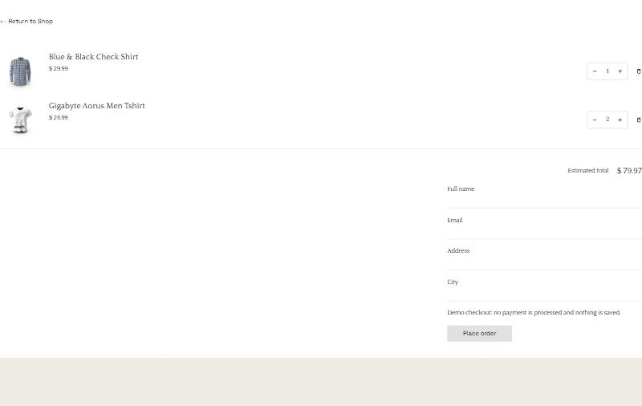
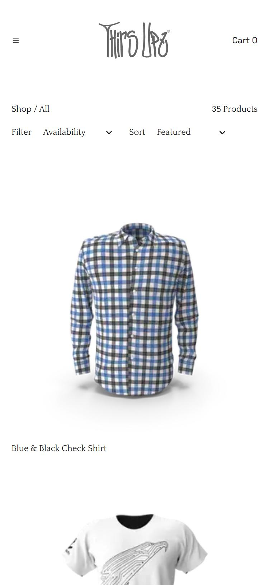

# Thirs Upz

> Tienda de ropa online desarrollada con Next.js, TypeScript y Tailwind CSS como proyecto de portfolio.


**Demo:** [thirs-upz.vercel.app](https://thirs-upz.vercel.app/)

---

## Descripción

Thirs Upz es una tienda de ropa online construida con Next.js. Permite a los usuarios explorar un catálogo de productos de moda, filtrarlos por disponibilidad y precio, ver el detalle de cada producto, gestionarlos en un carrito de compras persistente y completar un checkout simulado.

Los productos se consumen desde la API pública [DummyJSON](https://dummyjson.com/), filtrando las categorías de ropa y calzado disponibles. El proyecto no tiene base de datos ni backend propio: los datos se piden desde el servidor de Next.js, el carrito vive en el navegador y el checkout se valida y se recalcula en el servidor sin cobrar ni guardar nada.

## Capturas









*Catálogo en móvil.*

---

## Funcionalidades

- **Catálogo de productos** filtrado por categorías de moda y calzado
- **Filtros** por disponibilidad (en stock / sin stock) y orden por precio, con un mensaje cuando no hay resultados
- **Paginación** con estado reflejado en la URL via query params
- **Vista de producto** con galería de imágenes y selector de cantidad limitado por el stock
- **Carrito de compras** con persistencia en `localStorage`, con un tope de 10 unidades por producto y nunca por encima del stock
- **Checkout simulado** con formulario validado (Zod y React Hook Form), recálculo del pedido en el servidor y página de confirmación
- **Estados de carga, de error y de página no encontrada** (404) en el catálogo y en el detalle
- **Accesibilidad:** menú lateral operable con teclado (Escape, foco atrapado y devuelto), foco visible en todos los controles, paginación en un `nav` y texto alternativo distinto en cada imagen de la galería
- **Suscripción al newsletter** con validación de correo (demostración, no guarda datos)
- **Páginas** de inicio, tienda, producto, carrito, confirmación de pedido, about y contacto

---

## Tecnologías

| Tecnología                                                | Uso                                                                  |
| --------------------------------------------------------- | -------------------------------------------------------------------- |
| [Next.js 16](https://nextjs.org/)                         | App Router, Server Components y Server Actions                       |
| [React 19](https://react.dev/)                            | Suspense, hook `use` y React Compiler                                |
| [TypeScript](https://www.typescriptlang.org/)             | Tipado estático                                                      |
| [Tailwind CSS v4](https://tailwindcss.com/)               | Estilos con design tokens via CSS variables                          |
| [Zustand](https://zustand-demo.pmnd.rs/)                  | Estado global del carrito con persistencia                           |
| [Zod](https://zod.dev/)                                   | Validación del formulario y del pedido, en cliente y en servidor     |
| [React Hook Form](https://react-hook-form.com/)           | Estado y errores del formulario de checkout                          |
| [DummyJSON](https://dummyjson.com/)                       | API pública de productos                                             |
| [React Icons](https://react-icons.github.io/react-icons/) | Iconos                                                               |
| [Vitest](https://vitest.dev/)                             | Tests del carrito, del servicio de datos, del pedido y de la lista   |

---

## Estructura del proyecto

```
src/
├── app/
│   ├── layout.tsx           # Layout raíz con Header y Footer
│   ├── page.tsx             # Página de inicio (hero con imagen animada)
│   ├── not-found.tsx        # Página 404
│   ├── about/page.tsx       # Página about
│   ├── contact/page.tsx     # Página de contacto con suscripción al newsletter
│   ├── shop/
│   │   ├── page.tsx         # Catálogo: pide los productos en el servidor
│   │   ├── error.tsx        # Estado de error del catálogo
│   │   └── [id]/
│   │       ├── page.tsx     # Detalle de producto (Server Component con metadatos)
│   │       ├── loading.tsx  # Estado de carga del detalle
│   │       └── error.tsx    # Estado de error del detalle
│   └── checkout/
│       ├── page.tsx         # Carrito y formulario de checkout
│       └── success/page.tsx # Confirmación del pedido
├── components/              # Componentes globales reutilizables
├── features/                # Módulos por funcionalidad
│   ├── cart/                # Vista del carrito
│   ├── checkout/            # Formulario, esquema de Zod, acción de servidor y resumen del pedido
│   ├── email/               # Suscripción al newsletter (demo)
│   ├── filter/              # Filtros y ordenamiento del catálogo
│   ├── footer/              # Footer con navegación y redes sociales
│   ├── header/              # Header con menú lateral accesible y contador de carrito
│   ├── products/            # Lista, detalle y lógica de filtrado y paginado
│   │   ├── Products.tsx     # Lista con paginación (lee la URL y dibuja)
│   │   ├── ProductDetail.tsx
│   │   └── product-list.ts  # Leer opciones, filtrar, ordenar y paginar (función pura, con tests)
│   └── shop/                # Composición de la tienda (filtros + lista)
├── services/
│   └── http.ts              # Capa de acceso a la API (getClothingProducts, getProductById, HttpError)
├── store/
│   └── cart-store.ts        # Estado del carrito con Zustand persist
├── constants/
│   ├── cart.ts              # Límites de cantidad por producto
│   ├── navigation.ts        # Menús de navegación, legales y redes sociales
│   └── products.ts          # Categorías de ropa, opciones de disponibilidad y de orden
├── types/
│   ├── product-type.ts      # Tipos ProductType y ApiResponse
│   ├── cart-item-type.ts    # Tipo CartItem (lo que guarda el carrito)
│   └── order-type.ts        # Tipo Order (pedido confirmado)
└── styles/
    └── globals.css          # Design tokens, tipografía y foco visible
```

Los tests (`*.test.ts`) viven junto al código que prueban.

---

## Instalación y uso

Requiere Node.js 20.9 o superior.

```bash
# Clonar el repositorio
git clone https://github.com/Alejandro-64/thirs-upz.git
cd thirs-upz

# Instalar dependencias
npm install

# Crear el archivo de variables de entorno
cp .env.example .env

# Ejecutar en desarrollo
npm run dev
```

Abre [http://localhost:3000](http://localhost:3000) en tu navegador.

### Variables de entorno

| Variable              | Descripción                                    | Valor de ejemplo                   |
| --------------------- | ---------------------------------------------- | ---------------------------------- |
| `NEXT_PUBLIC_URL_API` | URL base de la API de productos (sin consulta) | `https://dummyjson.com/products`   |

Sin esta variable la aplicación lanza un error al arrancar. El archivo `.env.example` trae el valor de ejemplo.

### Scripts

| Comando         | Qué hace                                  |
| --------------- | ----------------------------------------- |
| `npm run dev`   | Servidor de desarrollo                    |
| `npm run build` | Compilación de producción                 |
| `npm start`     | Sirve la compilación de producción        |
| `npm run lint`  | Revisa el código con ESLint               |
| `npm test`      | Corre los tests con Vitest                |

## Lighthouse

Medido con Lighthouse 13.6 en móvil, con la mediana de 3 ejecuciones.

| Métrica                        | Tienda antes | Tienda después | Inicio antes | Inicio después |
| ------------------------------ | ------------ | -------------- | ------------ | -------------- |
| Rendimiento                    | 60           | 87             | 64           | 68             |
| Accesibilidad                  | 92           | 96             | 95           | 95             |
| Buenas prácticas               | 96           | 96             | 100          | 100            |
| SEO                            | 100          | 100            | 100          | 100            |
| Largest Contentful Paint (LCP) | 4,4 s        | 3,6 s          | 98,8 s       | 38,2 s         |
| Cumulative Layout Shift (CLS)  | 0,345        | 0              | 0,034        | 0              |
| Peso de la página              | 0,41 MB      | 0,49 MB        | 19,97 MB     | 7,52 MB        |

"Antes" es la versión de `main` desplegada en Vercel; "después" es la compilación de producción de esta rama servida en local con el mismo Chrome. En la página de inicio, la imagen animada de la portada sigue siendo el principal cuello de botella.

---

## Decisiones técnicas

**Capa de servicios y datos pedidos en el servidor** — `services/http.ts` concentra el acceso a la API: un helper genérico `http<T>` que lanza un `HttpError` con el código de estado si la respuesta no es correcta, y las funciones `getClothingProducts` y `getProductById`. Las páginas son Server Components, así que la URL de la API no se repite en los componentes y las respuestas se cachean una hora (`revalidate`).

**Solo viajan las prendas al navegador** — la API devuelve todo el catálogo (unos 190 productos, incluyendo belleza y comestibles). `getClothingProducts` filtra en el servidor las categorías definidas en `constants/products.ts`, así que al cliente solo llegan los productos que se muestran.

**Carga, error y página no encontrada** — el catálogo crea la promesa en el servidor y los componentes cliente la leen con `use()` dentro de un `<Suspense>`, que muestra el estado de carga. Si la petición falla, el `error.tsx` de la ruta muestra el mensaje. Si el producto no existe (la API responde 404), el detalle llama a `notFound()` y se muestra la página 404 en lugar de un error genérico.

**Filtros y paginación via URL** — los filtros de disponibilidad, orden y página se almacenan como query params (`?availability=inStock&sort=price-asc&page=2`). Esto permite compartir URLs con el estado aplicado y mantener el filtro al navegar hacia atrás. Los valores desconocidos se ignoran, una página inválida (negativa, decimal o fuera de rango) vuelve a la primera y cambiar un filtro reinicia la página.

**Filtrar, ordenar y paginar como función pura** — `product-list.ts` lee las opciones de la URL y, dadas las opciones y los productos, devuelve el total, el número de páginas y los productos de la página actual. Al no depender de React, se prueba con tests sencillos, y tanto el contador de productos del filtro como la lista lo calculan sin estado compartido ni efectos.

**Checkout simulado con validación en el servidor** — el formulario valida con Zod y React Hook Form. Al enviarlo, una acción de servidor vuelve a validar los datos con el mismo esquema y recalcula el pedido: el navegador solo manda identificadores y cantidades, y los precios y el stock salen de la API, de modo que el total no se puede manipular desde el cliente. No se cobra ni se guarda nada.

**El carrito guarda solo lo que necesita** — `CartItem` contiene únicamente `id`, `title`, `price`, `thumbnail`, `stock` y `quantity`; `ProductType` describe lo que devuelve la API, sin cantidad. Los límites (10 unidades y el stock del producto) se aplican dentro del store, no en los botones, así que se respetan aunque la interfaz cambie, y el store tiene tests para ello.

**Selectores derivados en Zustand** — `TOTAL_QUANTITY` y `TOTAL_PRICE` son funciones selectoras definidas fuera del store que calculan valores derivados del carrito, evitando duplicar lógica en los componentes.

**Persistencia del carrito con Zustand `persist`** — el carrito sobrevive recargas de página almacenándose en `localStorage` automáticamente via middleware.

**Accesibilidad de teclado** — un único estilo `:focus-visible` en `globals.css` da foco visible a todos los controles. El menú lateral declara `aria-expanded` y `aria-controls`, se cierra con Escape, mueve el foco al abrirse, lo devuelve al botón al cerrarse y mantiene Tab dentro del panel mientras está abierto.

**Tipografía dual** — Quattrocento (serif) como fuente principal para el cuerpo y Space Grotesk (sans-serif) como fuente secundaria, dando un contraste editorial acorde a la estética de la marca.

> **Nota:** esto es una demostración. El checkout valida y recalcula el pedido pero no procesa pagos reales ni guarda pedidos, la suscripción al newsletter no guarda ningún dato y el proyecto no tiene base de datos.
